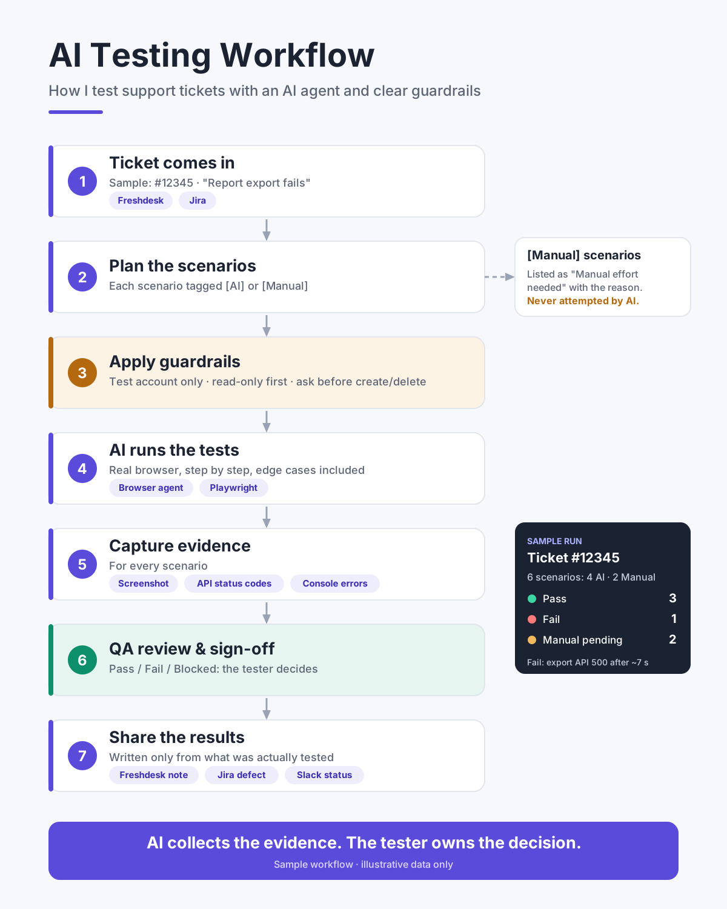

# AI Testing Workflow

An AI agent that tests support tickets inside the tools a QA engineer already uses: **Freshdesk, Jira, Slack and Playwright / a real browser**. The tester stays in control.

> All examples in this repo use **sample data only**. No real company, customer or ticket data.

---

## The idea in one line

**The AI collects the evidence. The tester owns the decision.**

Most QA time isn't spent on testing itself. It goes on everything around it:
read the ticket → check Jira → reproduce → screenshot → check API calls and console → write the note → update the team.

This workflow hands that legwork to an AI agent while keeping strict rules around it.

---

## How it works

| Step | What happens | Tools |
|---|---|---|
| 1. Ticket comes in | The agent reads the ticket and its history | Freshdesk, Jira |
| 2. Plan the scenarios | Each scenario is tagged **[AI]** or **[Manual]** | Test plan template |
| 3. Apply guardrails | Test account only · read-only first · ask before create/delete | — |
| 4. AI runs the tests | Step by step in a real browser, edge cases included | Browser agent, Playwright |
| 5. Capture evidence | Screenshot · API status codes · console errors, for every scenario | — |
| 6. QA review & sign-off | The tester reviews Pass / Fail / Blocked and decides | Human |
| 7. Share the results | Ticket note, Jira defect and Slack status, drafted for approval | Freshdesk, Jira, Slack |

---

## Guardrails (the important part)

1. **Run only [AI] scenarios.** [Manual] ones are listed under "Manual effort needed" with a reason and are never attempted.
2. **Read-only first.** Scenarios that only view data run before anything that changes data.
3. **Ask before create or delete.** The agent stops and asks before any step that creates or deletes data.
4. **Test account only.** Never touch customer or production data.
5. **Evidence for every result.** Pass / Fail / Blocked, plus a screenshot, API status codes and console errors.
6. **Report only what was tested.** Untested parts are marked "Manual testing pending".
7. **Nothing is posted without approval.** Notes, defects and Slack updates are drafts until the tester says yes.
8. **Clean up.** Test data created during the run is deleted at the end, or listed if it can't be.

The full prompt is in [`run-prompt.md`](run-prompt.md).

---

## Sample run

Ticket **#12345 – "Report export fails for large date ranges"** (sample)

| Scenario | Type | Result | Evidence |
|---|---|---|---|
| 1. Report loads for 7 days | AI · read-only | ✅ Pass | 200, 1.2 s, no console errors |
| 2. Export for 7 days | AI · read-only | ✅ Pass | 200, file 48 KB |
| 3. Export for 12 months | AI · read-only | ❌ Fail | 500 after ~7 s |
| 4. Double-click Export | AI · read-only | ✅ Pass | 1 request only |
| 5. Export as a limited-role user | Manual | ⏳ Pending | Needs a second login |
| 6. Export on mobile app | Manual | ⏳ Pending | Needs a device |

Full sample run (all sample data):
[test plan](test-plan.md) → [run report](report.md) → [ticket note](ticket-note.md) → [Jira defect draft](jira-defect-draft.md) → [Slack status](slack-status.md)

In a real run, each scenario also gets a screenshot plus a log of API calls, status codes, timings and console errors. They're not included here because this repo uses sample data only.

---

## Use it yourself

1. Copy [`test-plan-template.md`](test-plan-template.md) and fill in your scenarios.
2. Give your AI agent [`run-prompt.md`](run-prompt.md) together with the test plan.
3. Let it run, review the evidence, and approve what gets posted.

Works with any AI agent that can drive a browser (or Playwright) and connect to your ticketing and chat tools.

---

## What I learned

- **The rules matter more than the model.** "Ask before create/delete" and "report only what you tested" are what make the output trustworthy.
- **It catches edge cases people skip** at the end of a long day: double clicks, cancel-then-retry, duplicates, state after reload.
- **The tester still owns the judgement.** The AI never signs off.

## License

MIT
